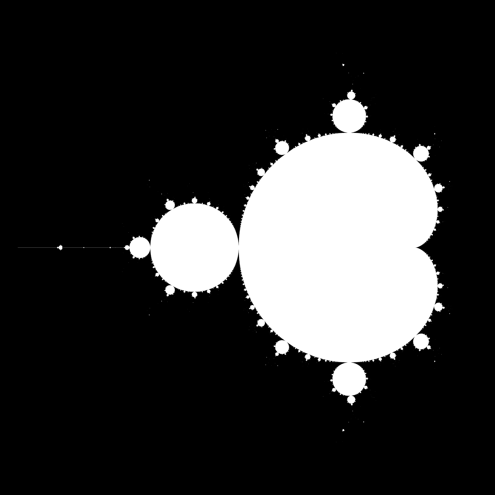

# High-Performance Computing Lab for CSE — Projects

Coursework and implementations for the **High-Performance Computing Lab for Computational Science and Engineering (HPC4CSE)** at **ETH Zürich**.

This repository collects seven projects covering the progression from single-node performance analysis and shared-memory parallelism to distributed-memory programming, scientific computing frameworks, and GPU acceleration. Alongside the implementations, it contains benchmarking scripts, scaling studies, plots, and detailed technical reports.

**Author:** [Riccardo Polo](https://github.com/Riccardo-Polo) · **Course:** High-Performance Computing Lab for CSE

## Projects at a glance

| Project | Main topics | Technologies | Report |
| --- | --- | --- | --- |
| [01 — Performance fundamentals](project01/) | Euler cluster, memory hierarchy, STREAM, roofline analysis, matrix multiplication | C, C++, OpenBLAS, Python, Slurm | [PDF](project01/project01_report/project_1_polo_riccardo.pdf) |
| [02 — Shared-memory parallelism](project02/) | OpenMP, numerical integration, Mandelbrot, synchronization, histograms, quicksort | C, C++, OpenMP | [PDF](project02/project02_report/project_02_polo_riccardo.pdf) |
| [03 — OpenMP PDE mini-app](project03/) | Fisher reaction–diffusion equation, finite differences, Newton/CG solvers, scalability | C++, OpenMP, Python | [PDF](project03/project03_report/project_03_polo_riccardo.pdf) |
| [04 — Distributed-memory parallelism](project04/) | MPI collectives, Cartesian topologies, halo exchange, Mandelbrot, power method | C, MPI, Python | [PDF](project04/project04_report/project_04_polo_riccardo.pdf) |
| [05 — MPI mini-app and Python](project05/) | Distributed Fisher solver, MPI-IO, strong/weak scaling, mpi4py, manager–worker scheduling | C++, MPI, Python, mpi4py | [PDF](project05/project05_report/project_05_polo_riccardo.pdf) |
| [06 — Graphs and HPC frameworks](project06/) | Graph partitioning, Julia, METIS, PETSc, parallel 2D Poisson equation | Julia, C, PETSc, MPI | [PDF](project06/project06_report/project_06_polo_riccardo.pdf) |
| [07 — GPU computing](project07/) | GPU roofline model, CUDA kernels, parallel reductions, GPU Fisher solver | CUDA C++, Python | [PDF](project07/project07_report/project_07_polo_riccardo.pdf) |

**All project reports:** [Combined PDF](projects_merged.pdf). The original assignment PDFs for Projects 1–6 are also available as `project0N/project0N.pdf`.

## Project details

### [Project 01 — Performance fundamentals](project01/)

Introduction to the **Euler HPC cluster** and the practical limits of CPU performance.

- Run C++ programs through **Slurm** and inspect compute-node characteristics.
- Analyze CPU peak floating-point throughput, cache/memory hierarchy, and attainable bandwidth using **STREAM**.
- Construct and interpret a **roofline performance model**.
- Compare matrix multiplication implementations: naïve loop ordering, reordered loops, cache blocking, and an optimized **BLAS DGEMM** reference.
- Examine compiler optimizations and auto-vectorization.

**Code:** [Euler warm-up](project01/1_Euler_Warmup/) · [Performance characteristics](project01/2_Performance_characteristics/) · [Matrix multiplication](project01/4_Matrix_Multiplication/)

### [Project 02 — Shared-memory parallelism with OpenMP](project02/)

Explore parallel programming on multicore CPUs and the impact of synchronization and workload distribution.

- Compute π by numerical integration, comparing serial execution, naïve and optimized critical sections, and **OpenMP reductions**; evaluate strong and weak scaling.
- Render the **Mandelbrot set** in serial and parallel, including scaling experiments.
- Identify common OpenMP bugs involving races, synchronization, and data sharing.
- Implement parallel histograms, handle loop-carried dependencies, and parallelize quicksort.

**Code:** [π integration](project02/01_pi_OPENMP/) · [Mandelbrot](project02/02_Mandelbrot/) · [Bug hunt](project02/03_bugs/) · [Histograms](project02/04_histograms/) · [Dependencies](project02/05_dependecies/) · [Quicksort](project02/06_quicksort/)



### [Project 03 — Parallel nonlinear PDE mini-app](project03/)

Implement and optimize a two-dimensional **Fisher reaction–diffusion** solver.

- Discretize the PDE with a **second-order finite-difference stencil** and implicit Euler time stepping.
- Solve the resulting nonlinear system using **Newton's method**, with a matrix-free **Conjugate Gradient** solver for linearized systems.
- Implement numerical linear algebra operations and the diffusion stencil in serial C++.
- Parallelize the relevant kernels with OpenMP and analyze **strong/weak scaling** and time to solution.

**Code:** [Serial implementation](project03/01_serial/) · [OpenMP implementation and scaling studies](project03/02_omp/)

### [Project 04 — Distributed-memory parallelism with MPI](project04/)

Introduce message-passing algorithms and distributed data layouts.

- Parallelize π integration using **MPI_Reduce** and examine scaling.
- Implement a ring-based sum and a **two-dimensional Cartesian communicator**.
- Exchange **ghost/halo cells**, including a derived MPI datatype for noncontiguous column boundaries (the ghost-cell exercise uses 12 ranks).
- Distribute Mandelbrot image generation across processes.
- Implement distributed **matrix–vector multiplication** and the **power method** using row-wise partitioning, with correctness checks and single-/multi-node scaling studies.

**Code:** [MPI π](project04/01_pi/) · [Ring sum](project04/02_ring_sum/) · [Ghost cells](project04/03_ghost/) · [Mandelbrot](project04/04_mandel/) · [Power method](project04/05_powermethod/)

### [Project 05 — MPI PDE solver and high-performance Python](project05/)

Extend the Fisher mini-app to distributed memory and investigate parallel programming in Python.

- Decompose the 2D PDE domain across MPI processes and exchange stencil boundary values.
- Parallelize the numerical kernels and use **collective MPI-IO** to write the global solution.
- Measure strong/weak scaling and examine communication versus computation; the report also discusses overlap of the two.
- Use **mpi4py** for reductions and neighboring-process exchanges.
- Build a dynamic **manager–worker** implementation of Mandelbrot computation, including scheduling and scaling experiments.

**Code:** [Distributed PDE mini-app](project05/01_mini_app/) · [Python/MPI exercises](project05/02_hpc_python/)

### [Project 06 — Graph partitioning and PETSc](project06/)

Study load balancing and widely used scientific computing libraries.

- Implement and compare **coordinate, inertial, and spectral bisection**, as well as **recursive bisection**, in Julia.
- Use **METIS** as a reference partitioner; inspect partition quality through edge cuts and visualizations of the supplied meshes and geographic graphs.
- Develop a parallel finite-difference solver for the **2D Poisson equation** with homogeneous Dirichlet boundary conditions using **PETSc**.
- Use PETSc's **DMDA**, **KSP**, and preconditioning infrastructure, and investigate strong scaling.

**Code:** [Julia graph partitioning](project06/01_graph/) · [PETSc examples and Poisson solver](project06/02_petsc/)

### [Project 07 — GPU programming with CUDA](project07/)

Analyze GPU hardware performance and move computational kernels to an accelerator.

- Estimate GPU peak performance, memory bandwidth, and roofline limits.
- Implement and benchmark elementary CUDA numerical kernels and vector operations.
- Implement a **parallel dot product/reduction** with on-device partial sums.
- Port the Fisher reaction–diffusion mini-app to **CUDA**, including device memory management, stencil and linear algebra kernels, and the nonlinear solver.

**Code:** [Performance analysis](project07/01_performance/) · [CUDA kernels](project07/02cuda/) · [GPU Fisher solver](project07/03_fisher/)

## Getting started

Clone the repository:

```bash
git clone https://github.com/Riccardo-Polo/HPC4CSE_Projects.git
cd HPC4CSE_Projects
```

There is **no single top-level build**: each executable is built from the `Makefile` in its own exercise directory. Requirements depend on the project:

| Component | Used for |
| --- | --- |
| GCC/G++ and GNU Make | C/C++ implementations |
| OpenMP-capable compiler | Projects 02–03 |
| MPI implementation (`mpicc`, `mpicxx`, `mpirun`/`mpiexec`) | Projects 04–06 and Python MPI exercises |
| OpenBLAS | Project 01 matrix-multiplication comparison |
| Python with NumPy and Matplotlib | Postprocessing, plots, and mini-app visualization |
| `mpi4py` | Project 05 Python MPI exercises |
| Julia with the supplied `Project.toml` and `Manifest.toml` | Project 06 graph partitioning |
| PETSc and `pkg-config` | Project 06 Poisson solver |
| NVIDIA GPU, CUDA Toolkit and `nvcc` | Project 07 |

Some plotting scripts also use **Gnuplot**. The Slurm scripts were written for the **Euler cluster** and load cluster-specific modules and hardware constraints; adapt them to the system on which you run the code.

### Examples: OpenMP and the serial PDE solver

```bash
# From the repository root: OpenMP π integration
cd project02/01_pi_OPENMP/part_one
make
OMP_NUM_THREADS=4 ./pi_omp_reduction 10000000

# Return to the repository root, then build the serial Fisher solver
cd ../../..
cd project03/01_serial
make
./main 128 10 0.01
```

For the Fisher mini-app, the positional arguments are `nx nt t [verbose]`: the number of grid points per spatial direction, the number of time steps, the total simulated time, and optional verbose output.

### Example: MPI

```bash
# From the repository root
cd project04/01_pi
make
mpirun -np 4 ./pi_mpi 10000000
```

On Euler, the provided `run_*.sh` scripts often use `sbatch` and `srun` to submit jobs and gather scaling data. The requested process count, modules, and resource constraints may need modification outside that environment.

### Example: Julia graph partitioning

```bash
# From the repository root
cd project06/01_graph
julia --project=. -e 'using Pkg; Pkg.instantiate()'
julia --project=. main.jl
```

The graph scripts use data in `Meshes/`, helpers in `Tools/`, and write visualizations to `images/`. Other entry points include `main_bench.jl` and `main_draw.jl`.

### Example: PETSc Poisson solver

With PETSc installed and discoverable by the Makefile through the expected environment variables and `pkg-config` configuration:

```bash
# From the repository root
cd project06/02_petsc/02_poisson_petsc/application
make
mpirun -np 4 ./poisson2d -da_grid_x 129 -da_grid_y 129 \
  -ksp_type cg -pc_type gamg -ksp_rtol 1e-10 \
  -solution_file solution.dat
python3 plot_solution.py
```

See the corresponding [Slurm run script](project06/02_petsc/02_poisson_petsc/application/run_poisson.sh) for the original cluster configuration.

### Example: CUDA

```bash
# From the repository root
cd project07/02cuda/01_simple_kernels
make
./benchmark
```

The CUDA Makefiles currently compile for **`sm_75`** (Turing). Override `NVCCFLAGS` for a different supported NVIDIA GPU architecture, if necessary; for example, `make NVCCFLAGS="-O3 -arch=sm_XX"` with `XX` replaced by your target architecture.

## Reports, data, and reproducibility

Each `project0N/` directory contains its implementation(s) and a `project0N_report/` folder with a **LaTeX report**, typically accompanied by a compiled PDF. The reports document design decisions, numerical methods, performance measurements, and scaling results. The root-level [`projects_merged.pdf`](projects_merged.pdf) combines the reports.

Benchmark results and plots are stored in the corresponding exercise directories, commonly under folders such as `results/`, `figures/`, `images/`, `outputs/`, or `build*/`. Some projects also retain provided skeleton code and reference material for comparison.

**Reproducibility note:** timings, peak performance, and scaling behavior depend on the architecture, compiler, threading configuration, MPI runtime, and problem size. The archived results were collected in a specific HPC environment and should not be assumed to reproduce identically on other machines.

## Acknowledgments

These projects were completed as part of the **High-Performance Computing Lab for CSE**. Several exercises build on course-provided skeleton code and reference material; the accompanying reports and source files retain further context and attributions.

---
*Repository maintained by [Riccardo Polo](https://github.com/Riccardo-Polo).*
